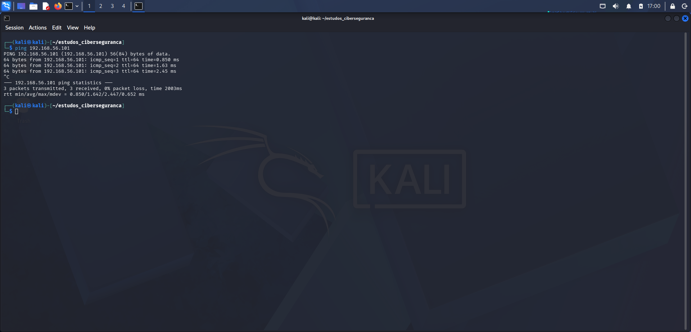
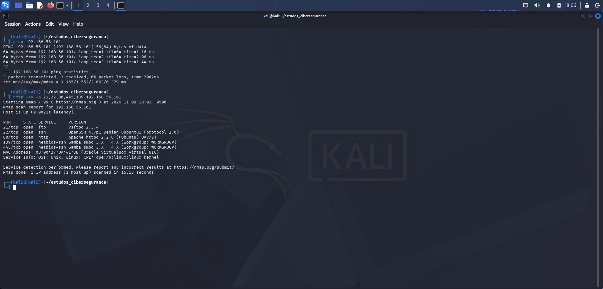
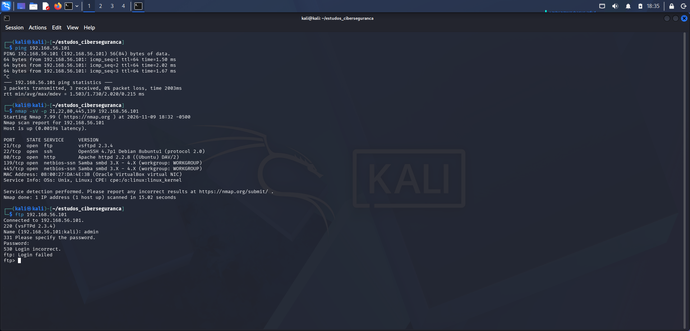

* Fase 1: Reconhecimento e Mapeamento de Rede

## 1. Teste de Conectividade (Ping)
Confirmou-se que a máquina alvo (**Metasploitable 2** - `192.168.56.101`) está ativa e a responder na rede Host-Only:

```bash
ping 192.168.56.101
```



## 2. Início de Varredura de Rede
Após o teste de conectividade, é realizado uma varredura contra o IP da máquina alvo a procura de portas abertas e suas respectivas versões utilizando o Nmap:

```bash
nmap -sV -p 21,22,80,445,139 192.168.56.101
```



Para confirmar que o serviço FTP está ativo, é feito um acesso direto na máquina alvo com o seguinte comando:

```bash
ftp 192.168.56.101
```


